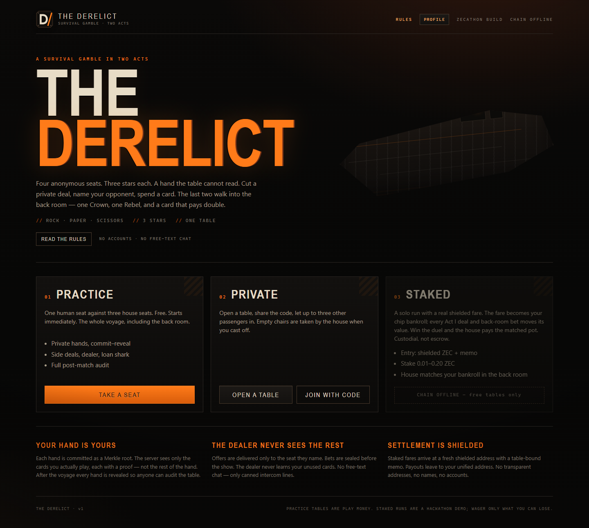
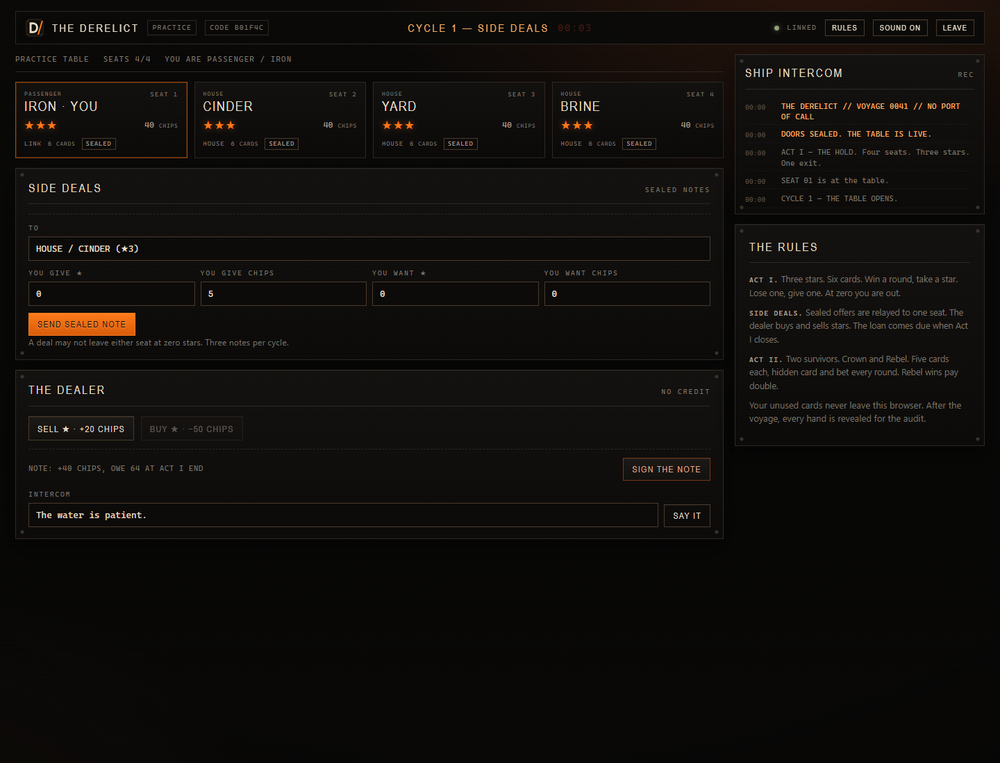
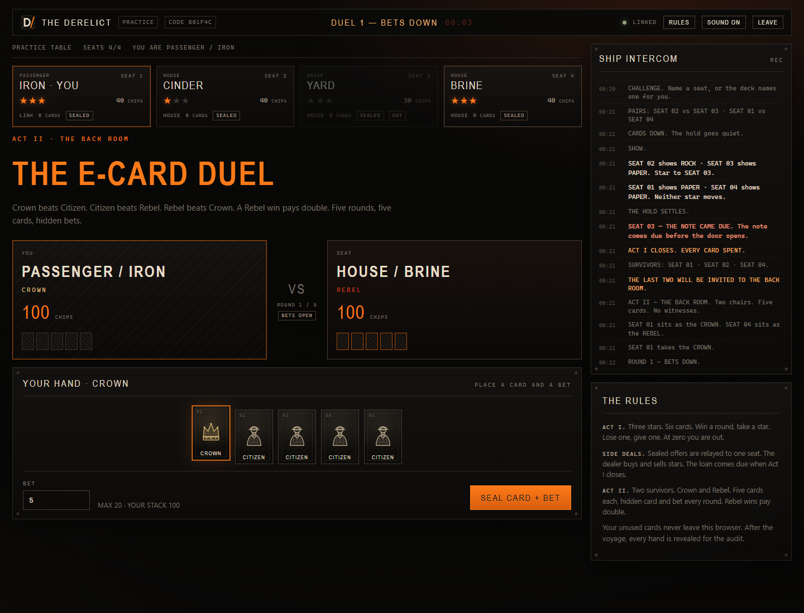

# THE DERELICT

**A survival gambling game where the table cannot read your hand — and the money moves in shielded ZEC.**

Built for [Zecathon 2026](https://thezecathon.com/) · **Wildcard track** · MIT licensed.

> Four anonymous seats. Six cards each. Three stars. A loan shark, a dealer, and a private
> side market. When the hold closes, the last two walk into the back room and play a
> hidden E-Card duel with the pot on the line. Every hand is committed before a card is
> shown, every play carries a proof, and after the voyage the whole table is revealed so
> anyone can audit it. Staked fares enter and leave as shielded Zcash transactions.

THE DERELICT is an original game inspired by the pressure-cooker gambling fiction of
Kaiji: The Ultimate Gambler. It uses no Kaiji names, characters, art, or catchphrases.

<p align="center">
  
</p>

<p align="center">
  
  
</p>

---

## Why this is a privacy game, not a game with a checkbox

A normal online card game asks you to trust the server with your whole hand. THE DERELICT
does not receive it.

1. **The browser builds the hand and commits to it.** Six cards (two rock, two paper, two
   scissors) are salted, hashed into a Merkle tree, and the root is committed as
   `SHA-256("derelict:v1|hand|" + tableId + "|" + seat + "|" + root)`. The cards and salts
   stay in the browser.
2. **Each play is a commitment, then a reveal.** The player commits
   `SHA-256("derelict:v1|play|" + tableId + "|" + cycle + "|" + seat + "|" + card + "|" + playSalt)`,
   and later reveals the card with its leaf salt and a Merkle inclusion proof. The server
   verifies the proof against the hand root before accepting the play.
3. **The dealer never sees the cards you did not play.** It learns one leaf per round,
   and it is structurally unable to substitute a card that is not in the committed hand.
   A leaf cannot be reused inside a hand.
4. **The back room seals both card and bet.** The E-Card duel uses a second committed hand
   and a play commitment that binds the card, the bet, and a fresh salt — so neither side
   can change a wager after seeing the other.
5. **After the phase closes, the hands are revealed.** Act I hands open once Act I is over;
   the duel hands open only after settlement. The server refuses a hand reveal while that
   hand can still be played, so the public audit cannot be used to expose a live hand.
   Both hands, both duel hands, every play, every offer outcome, the loan ledger, and the
   settlement arithmetic are published. A standalone verifier rebuilds every Merkle root
   and replays the star/chip ledger.

The server still sees the cards that are actually played (it has to resolve the round),
and it sees full hands after the match for the audit. It does not see the rest **during
play**. It also relays private offers, so the operator can read them; they are hidden from
the other players, not from the dealer. The precise guarantees and limits are in
[docs/THREAT-MODEL.md](docs/THREAT-MODEL.md).

---

## The game

### Act I — the hold

- Four seats, anonymous handles, three stars each, forty chips.
- Each seat commits a private six-card RPS hand (2× rock, 2× paper, 2× scissors).
- Each cycle: a **trade** phase (private one-to-one offers, a dealer who buys stars at 20
  and sells at 50, and a loan shark offering 40 chips for a 64-chip note), then a
  **challenge** phase where seats name an opponent, then simultaneous **play** and
  **reveal**.
- The winner of a pairing takes one star from the loser. A tie moves nothing. A seat that
  fails to reveal forfeits a star. If both freeze, the house burns a star from each.
- At zero stars a seat is **OUT**. The hold ends at two survivors, when fewer than two
  seats still hold cards, or at the cycle cap. Unpaid loans are seized at the end of Act I.
- The two highest-ranked survivors (stars, then chips) enter the back room. If only one
  survives, the house takes the empty chair.

### Act II — the E-Card duel

- The finalists are **CROWN** and **REBEL**. Each commits a hidden five-card hand: one
  SPECIAL and four CITIZENS.
- Five rounds. Each side seals a card **and a bet** (0–20 chips, capped by stack). Both are
  revealed together. The SPECIAL beats a CITIZEN; CITIZEN vs CITIZEN is a tie; SPECIAL vs
  SPECIAL is a tie. The REBEL's wins pay **2×** the matched bet; the CROWN's wins pay 1×.
- The higher chip stack after five rounds takes the pot. A tie splits it, and the house
  takes a split against a house seat.

### Staked solo runs

A solo run is one human against three house seats. The fare is a real shielded ZEC
transaction to a fresh address, bound by a memo (`derelict:<tableId>:<seat>`). The fare
becomes the player's bankroll: at the start of Act I each chip is worth
`stake / 40`, and every side deal, loan and dealer trade moves that value. The surviving
stack is rescaled onto 100 back-room chips, which the house matches. A human win pays the
matched pot (2× the bankroll); a split returns the bankroll; an Act I elimination or a lost
duel returns nothing. This is a custodial house bankroll, not an escrow contract — see the
threat model.

Practice and private tables are free and use play money.

---

## Zcash usage

- **Entry:** a fresh shielded address per staked table, generated by the house's `zecd`
  wallet. The player sends the exact stake with a table-bound memo. The server watches
  `listtransactions` for a receive row with that memo.
- **Payout:** `z_sendmany` from the house's shielded bankroll to the winner's unified
  address (`u1…`), with a payout memo. The regtest stack mines a block so the transaction
  confirms immediately.
- **No transparent addresses are used for settlement.** The house refuses to pay itself
  and validates that the player's payout address is a shielded address.
- The regtest demo can pay a player's fare from the house bankroll, so a judge can walk
  the whole flow without an external wallet. That path is regtest-only and clearly
  labelled in the UI; it still sends a real shielded transaction with the real memo.
- The top-right **PROFILE → TEST WALLET** creates a house-custodied shielded regtest address
  and a rate-limited faucet. The token also has a house-held ledger: paying a staked fare
  debits the ledger and sends the real shielded transaction, and a winning payout is
  credited back to it. It is a test fixture, not a private wallet.

---

## Run it

Requires Node 22.12+ (developed on Node 26).

```bash
npm install
npm run build        # build the React SPA into web/dist
npm run dev          # Vite on :5173, game server on :8791
```

Or serve the built SPA directly:

```bash
npm run build
npm run server       # http://127.0.0.1:8791
```

### Split deployment (Vercel front end + Railway backend)

The SPA is static and can run on Vercel. The game server needs a long-lived Node process
and WebSocket connections, so it belongs on Railway (or any Node host). This is optional;
the Docker stack below remains the recommended demo. For the split:

- build the front end with `VITE_API_BASE=https://<railway-host>` (and optionally
  `VITE_WS_BASE`), so API calls and the socket cross to the backend;
- set `APP_ORIGIN=https://<vercel-host>` on the server, which allows that exact origin for
  HTTP and the WebSocket upgrade;
- use `CHAIN_MODE=off` for free practice, or deploy the Zebra + zecd + bootstrap services
  and use `CHAIN_MODE=regtest` for the staked judge demo.

Vercel cannot host the Node/WebSocket server, and the full Zebra + zecd staked stack is
not a Vercel service. Full steps, Railway variables, volumes, and the staked-mode
setup are in [docs/DEPLOYMENT.md](docs/DEPLOYMENT.md). The checked-in
`vercel.json` and `railway.json` are the deployment metadata.

### Self-contained regtest stack (zebra + zecd + app)

```bash
cp .env.example .env
docker compose up --build -d
# open http://127.0.0.1:8791
```

The stack mines 105 regtest blocks, restores the **public BIP-39 test-vector** wallet,
shields the coinbase, and starts the game. The seed is a published spec vector and the
chain is private to this compose project; never put a real seed in `.env`.

To record or drive an automated demo quickly, set `PHASE_SCALE=0.1` in `.env` (default
`1`) and rebuild the app container. At that scale the trade and play windows are too short
to play by hand; use the default for a real browser session.

The staked flow has two demo paths. **PROFILE → TEST WALLET** requests test ZEC, then the
deposit screen's **PAY THE FARE FROM TEST WALLET** debits that ledger and sends the real
shielded fare with the table memo. The **REGTEST · LET THE HOUSE COVER THE FARE** button
sends the same transaction from the house bankroll without the wallet, for runs opened with
an external payout address. Both end at the normal deposit watcher, so entry, play, payout,
and audit can be seen end to end.

### Tests

```bash
npm test             # engine/rule, bankroll/ledger, pacing, privacy-gate, and audit-tamper tests
npm run e2e          # headless human vs. three bots, then client-side audit
npm run ui           # headless Chrome voyage + screenshots in e2e/
npm run ui:stake     # headless Chrome staked flow against the Docker stack
npm run ui:modals    # rules, leave, loan, test-wallet, and mobile dialog sheets against the Docker stack
npm run stack        # staked run against the running Docker regtest stack
```

`npm run stack` creates a solo table, pays the fare through the regtest house-funding
endpoint, plays the voyage, verifies the audit, and — when the human takes the pot —
checks the shielded payout txid.

The browser tests use `puppeteer-core` (a dev dependency) and drive an installed Chrome.
Set `CHROME_PATH` if it is not at the default Windows path, and `DERELICT_URL` to point at
another server.

### Verify an audit yourself

Every settled table exposes `GET /api/tables/:id/audit`. To verify one independently:

```bash
node scripts/verify-audit.mjs e2e/audit.json
```

The verifier is also bundled into the browser; the result screen runs it locally and shows
the verdict. It checks, among other things:

- every Act I hand rebuilds to its committed Merkle root, with exactly two of each card;
- every play commitment, leaf hash, leaf-uniqueness rule, and inclusion proof;
- every round outcome against the revealed cards, and the star transfers;
- the full star/chip ledger including trades, dealer operations, loans, and debt seizure;
- the finalists, the duel hands, every duel commitment and bet, and the chip transfers;
- the settlement arithmetic, and that the audit is complete.

A complete audit does **not** prove the money moved. Chain settlement is checked
separately by the player's wallet and the server's payout record.

---

## Repository layout

```
shared/          rules, crypto/commitments, E-Card logic, audit verifier
server/          game engine, WebSocket/HTTP front door, zecd/Zebra chain adapter
web/             React SPA (Vite), hand generation in the browser, audit panel
scripts/         dev runner, audit CLI, simulation
e2e/             protocol, browser, and staked-regtest end-to-end tests
regtest/         zebrad and zecd configs for the private demo chain
docker/zecd/     regtest funder image and self-initializing entrypoint
docs/            protocol, threat model, deployment, screenshots, and submission notes
vercel.json      static-SPA build for a split Vercel deployment
railway.json     Node/WebSocket service for a split Railway deployment
```

## Honest limitations

- **Composition is audited, not prevented.** A player can commit a hand that is not
  2×/2×/2×; the server cannot tell without learning the cards. The audit catches it after
  settlement, but the game does not stop it live.
- **The house knows its own bots' hands.** House seats are server-run. The human's unused
  cards are the thing the dealer does not learn during play.
- **The server is trusted for availability and for the money.** It is the bankroll
  counterparty, not a smart contract. It can go offline, refuse a payout, or lie about a
  deposit; the audit covers the game ledger, not the chain.
- **Metadata is visible to the operator:** table timing, seat count, stake size, IP
  addresses, and the deposit/payout addresses it creates or receives. There is no Tor or
  mixnet integration.
- **The web client is trusted.** A compromised browser or a malicious build can leak the
  hand it holds; the protocol does not protect against a hostile client.
- **Offers are private from other players, not from the server.** They are relayed, not
  end-to-end encrypted.
- **No free-text chat.** Only canned intercom lines and taunts, by design.

## License

MIT. See [LICENSE](LICENSE).
